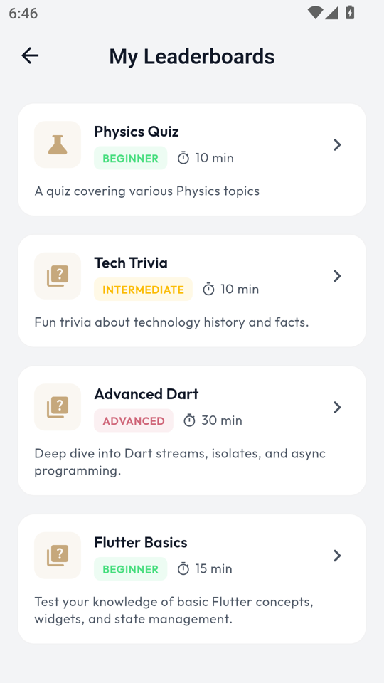
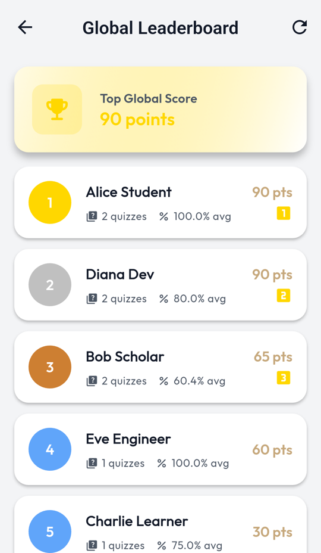
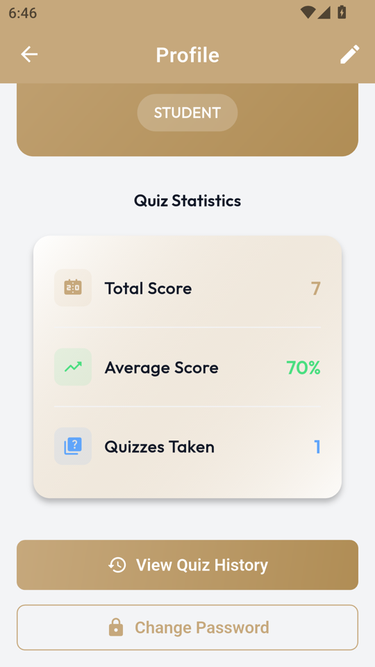
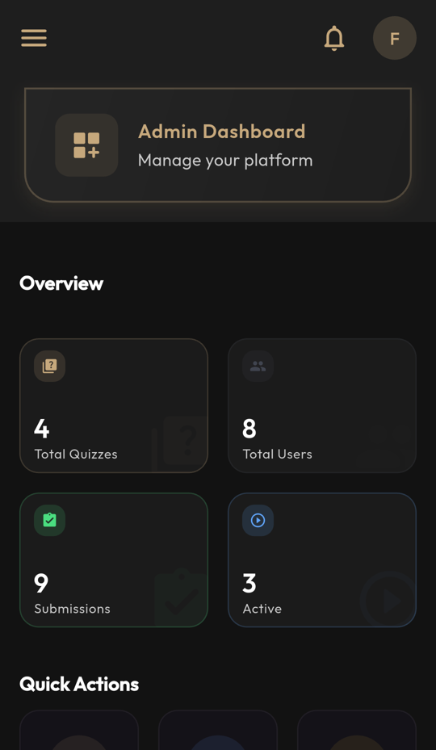
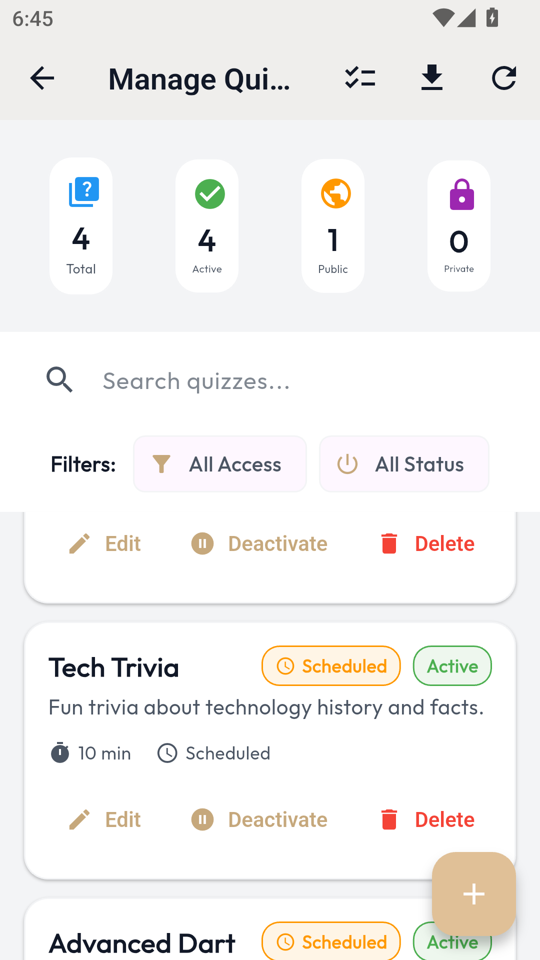
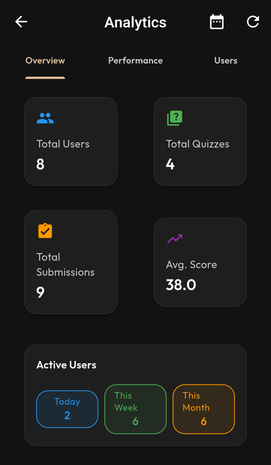
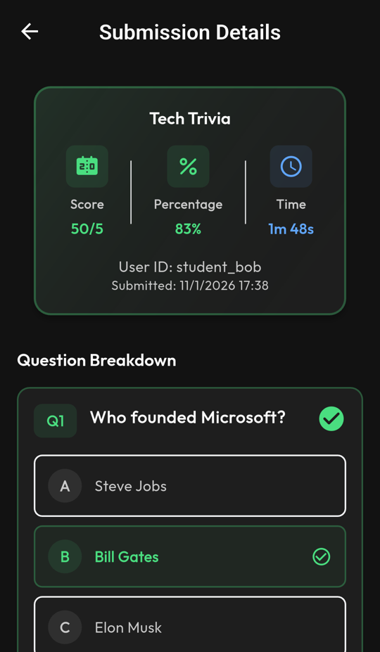

# Quiz Circle

   

A quiz platform for a study circle, class or training group. Admins create and publish timed quizzes; students take them on their phones, see their results and compete on leaderboards. Built with Flutter and Firebase, with push notifications driven by Cloud Functions.

## Screenshots

**Students**

| Quizzes | Leaderboard | Profile |
|:---:|:---:|:---:|
|  |  |  |

**Admins**

| Dashboard | Manage quizzes | Analytics | Submission review |
|:---:|:---:|:---:|:---:|
|  |  |  |  |

## Features

**Students**
- Sign up / sign in with email and password
- Browse published quizzes and take them against a countdown timer
- Instant results with correct answers, plus full quiz history
- Per-quiz and global leaderboards
- Push notifications for new quizzes, quiz updates and announcements

**Admins**
- Dashboard with recent activity and analytics charts
- Create and edit quizzes in the app, or bulk-import them from CSV with validation and preview
- Manage users and roles
- Review every submission in detail
- Post announcements to all students

**Platform**
- Firestore security rules with role-based access (only admins can write quizzes)
- Firebase App Check
- Cloud Functions for notification fan-out and scheduled cleanup of old notifications

## Tech stack

| Area | Technology |
|---|---|
| App | Flutter 3, Material 3 |
| State and routing | Riverpod 3, GoRouter |
| Backend | Firebase Auth, Cloud Firestore, Storage, Cloud Messaging, App Check |
| Server | Cloud Functions (Node.js) |
| Charts | fl_chart |
| Import | csv, file_picker |

## Architecture

Clean architecture per feature (data / domain / presentation):

```
lib/
├── app/          app shell, router, theme
├── core/         services (Firebase, notifications), models, errors, validators
├── features/
│   ├── authentication/
│   ├── quiz/            quiz list, attempt, results, history, leaderboards
│   ├── admin/           dashboard, quiz editor, CSV import, users, submissions, analytics
│   ├── announcements/
│   ├── notifications/
│   ├── student/
│   └── profile/
└── shared/       shared widgets and providers
functions/        Cloud Functions (notifications, cleanup)
firestore.rules   security rules
```

## Getting started

**Requirements:** Flutter 3.24+, a Firebase project, and the Firebase CLI for rules and functions.

1. Create a Firebase project and enable **Authentication (email/password)**, **Firestore**, **Storage** and **Cloud Messaging**.
2. Register an Android app with package `com.knowlium.app` (or change `applicationId`) and place the downloaded `google-services.json` in `android/app/`. This file is git-ignored.
3. Set your project ID in `.firebaserc`, then deploy rules, indexes and functions:

   ```bash
   firebase deploy --only firestore:rules,firestore:indexes,functions
   ```

4. Run the app:

   ```bash
   flutter pub get
   flutter run
   ```

5. Give your user the admin role in Firestore (`users/{uid}.role = "admin"`) to unlock the admin dashboard.

Detailed steps: [docs/firebase-setup.md](docs/firebase-setup.md).

### Importing quizzes from CSV

A template and two test files are in [`samples/`](samples): `quiz_template.csv`, `valid_quiz.csv` and `invalid_quiz.csv` (to see validation errors).

### Release signing

Release builds read `android/key.properties` (git-ignored) with `storeFile`, `storePassword`, `keyAlias` and `keyPassword`. Without it, release builds fall back to debug signing.

Before publishing your own build, replace the placeholder contact address (`support@example.com`) in `assets/privacy_policy.html`.

## Testing

```bash
flutter test
```

Manual test cases are in [docs/manual-test-cases.md](docs/manual-test-cases.md).

_Developed December 2025 – January 2026. Imported from a private repository; the commit history was left out because it contained credentials._

## License

MIT. See [LICENSE](LICENSE).
